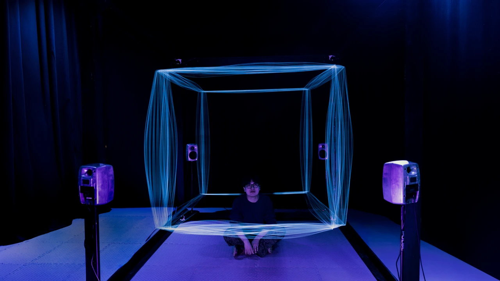
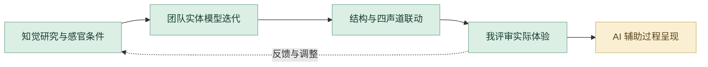

# 声学弹性

实体装置、四声道声音与 Max/MSP、Arduino 交互。

**[完整设计案例](https://xiongzhiyuan-portfolio.pages.dev/zh/work/sonic-elasticity/) · [求职作品总入口](https://github.com/Zhiyuan-Xiong/xiongzhiyuan-portfolio)**

## 项目目标

声学弹性是一件交互装置，探索如何通过受控的感官条件构建并重塑空间知觉。项目借鉴超立方体的几何逻辑，以时间作为感知变化的维度：弹性立方体缓慢伸缩，四声道声场随之变化，参与者对距离、尺度与空间边界的判断也在同步与偏离之间不断调整。

## 我的贡献

装置设计与制作（协作项目）

完成阶段：研究、模型迭代、实体装置与视听编程

现有产出：知觉实验、四轮迭代、结构模型、Max/MSP 与 Arduino 联动、装置影像

## 设计制作与 AI 协作工作流

将空间变化与四声道声音共同转为知觉体验。我参与装置设计与制作；AI 辅助当前研究资料、四轮迭代与视听关系的整理和数字展示。

| 阶段 | 制作、判断与 AI 协作 |
| --- | --- |
| **1. 从知觉问题定义体验** | 围绕距离、尺度和空间边界，结合超立方体与时间维度建立研究框架。首先明确希望观察的知觉变化，再提出装置方向。 |
| **2. 整理实验与判断依据** | 对照认知框架、实验、模型和四轮迭代，借助 AI 组织每轮修改的理由。我检查结构、感官条件和实际体验之间的关系。 |
| **3. 团队推进实体模型与结构** | 参与弹性立方体、连接关系和装置制作，用实体模型比较伸缩方式与空间体验。结构迭代和现场制作由专业操作与团队协作完成。 |
| **4. 连接声音与空间变化** | 团队通过 Max/MSP、Arduino 与四声道声场建立同步和偏离的视听关系。我在自己的装置设计与制作职责中配合联动验证。 |
| **5. Codex 展示研究和迭代** | 当前案例由 Codex 辅助将认知框架、四轮修改、构造细节和声音资料组织成可浏览页面。我决定对比顺序、资料注释与职责说明。 |
| **6. 用实物体验推动复盘** | 以现场体验、模型对比和影像判断结构、声音与参与者感知的关系，再将问题带回专业制作或 AI 辅助说明。保留实验、四轮迭代、结构与联动资料。 |

### 审美与专业评审

| 评审维度 | 我的专业判断 |
| --- | --- |
| **真实体验** | 实体变化与声音关系在现场可感知。 |
| **结构和细节** | 比较模型、连接方式与伸缩过程。 |
| **过程解释** | 四轮迭代能够说明为何改变设计。 |

**过程证据：** [认知框架](media/sonic/cognitive-framework-large.webp) · [迭代总览](media/sonic/iteration-overview-large.webp) · [结构制作](media/sonic/construction-board-large.webp) · [声音分析](media/sonic/audio-analysis-large.webp)

[阅读完整的项目工作流](工作流.md) · [我的 AI 设计方法](https://github.com/Zhiyuan-Xiong/xiongzhiyuan-portfolio/blob/main/docs/AI设计工作流.md)

## 仓库内容

- [media/](media/)：项目公开影像、图像与交互数据。
- [images/](images/)：作品集封面与不同尺寸展示图。
- [site-source/](site-source/)：对应案例文案、页面组件与相关交互实现。
- [case-data.json](case-data.json)：项目目标、职责、章节与产出信息。

## 查看与使用

GitHub 中可直接浏览图像、GIF、文案与实现文件。完整交互与影像观看入口为顶部的在线案例。网页组件的完整构建环境位于 [作品集总仓库](https://github.com/Zhiyuan-Xiong/xiongzhiyuan-portfolio)。

## 署名与使用

作品素材用于个人设计展示。协作项目以案例中的职责说明为准；字体、引擎和第三方资料遵循各自授权。未经许可，不将作品素材用于转载或商业用途。
