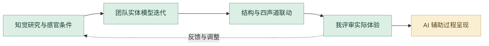

# 声学弹性｜详细设计与 AI 协作工作流

将空间变化与四声道声音共同转为知觉体验。我参与装置设计与制作；AI 辅助当前研究资料、四轮迭代与视听关系的整理和数字展示。

## 1. 从知觉问题定义体验

围绕距离、尺度和空间边界，结合超立方体与时间维度建立研究框架。首先明确希望观察的知觉变化，再提出装置方向。

## 2. 整理实验与判断依据

对照认知框架、实验、模型和四轮迭代，借助 AI 组织每轮修改的理由。我检查结构、感官条件和实际体验之间的关系。

## 3. 团队推进实体模型与结构

参与弹性立方体、连接关系和装置制作，用实体模型比较伸缩方式与空间体验。结构迭代和现场制作由专业操作与团队协作完成。

## 4. 连接声音与空间变化

团队通过 Max/MSP、Arduino 与四声道声场建立同步和偏离的视听关系。我在自己的装置设计与制作职责中配合联动验证。

## 5. Codex 展示研究和迭代

当前案例由 Codex 辅助将认知框架、四轮修改、构造细节和声音资料组织成可浏览页面。我决定对比顺序、资料注释与职责说明。

## 6. 用实物体验推动复盘

以现场体验、模型对比和影像判断结构、声音与参与者感知的关系，再将问题带回专业制作或 AI 辅助说明。保留实验、四轮迭代、结构与联动资料。

## 审美与专业评审

| 评审维度 | 我的专业判断 |
| --- | --- |
| **真实体验** | 实体变化与声音关系在现场可感知。 |
| **结构和细节** | 比较模型、连接方式与伸缩过程。 |
| **过程解释** | 四轮迭代能够说明为何改变设计。 |

## 过程证据

[认知框架](media/sonic/cognitive-framework-large.webp) · [迭代总览](media/sonic/iteration-overview-large.webp) · [结构制作](media/sonic/construction-board-large.webp) · [声音分析](media/sonic/audio-analysis-large.webp)

[项目原说明](README.md) · [完整 AI 方法](https://github.com/Zhiyuan-Xiong/xiongzhiyuan-portfolio/blob/main/docs/AI设计工作流.md)
